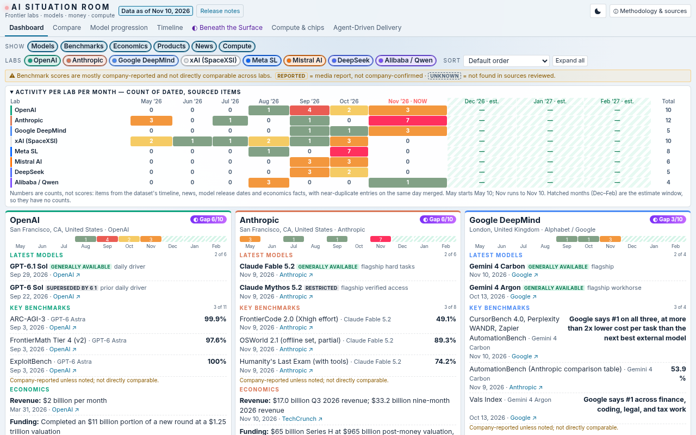

# AI Situation Room

A one-page dashboard that tracks the frontier AI labs (OpenAI, Anthropic, Google DeepMind, xAI, Meta, Mistral, DeepSeek and Alibaba/Qwen): models, benchmarks, economics, products, news and compute, with every item dated and sourced.

**Live:** https://ai-situation-room.vercel.app

## Why
AI moves so fast that I wanted one place to see the labs, models, benchmarks and money at a glance.



## Views
- **Dashboard**: a card for each lab, with filter chips, lab toggles, sorting and a monthly activity strip
- **Compare**: the labs side by side
- **Model progression**: each lab's model lineage and benchmark deltas
- **Timeline**: May 2026 to now, with clearly labelled estimates beyond
- **Beneath the Surface**: what labs say compared with what the data shows
- **Compute & chips**
- **Agent-Driven Delivery**: a weekly brief

## Run it
It's a plain static site with no build step and no external JavaScript. Open `index.html` in a browser, or run:

```
python3 -m http.server
```

Styles are Tailwind CSS v4, compiled to `style.css`. The data lives in `data/`.

## Contributing
Feel free to use it, fork or clone it, and open an issue or pull request with ideas. Collaboration is welcome.

## Support
Support this project: donations accepted via X Money to [@thesam](https://x.com/thesam).
