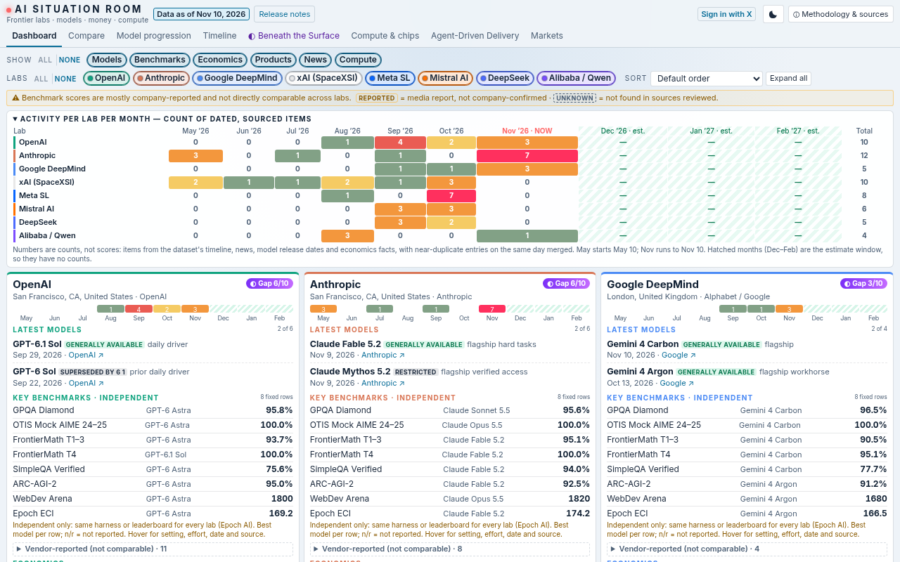
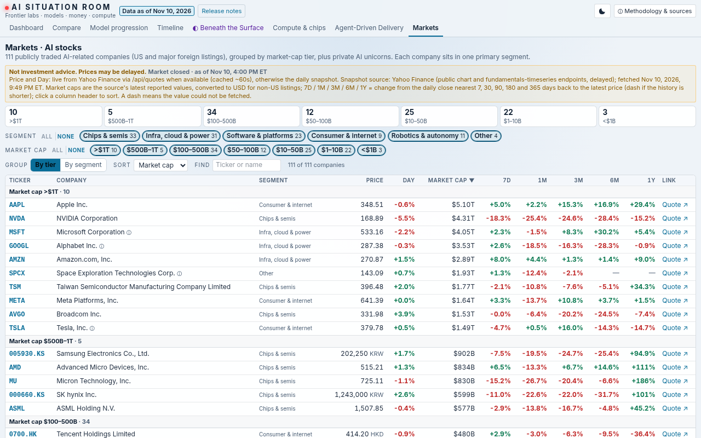
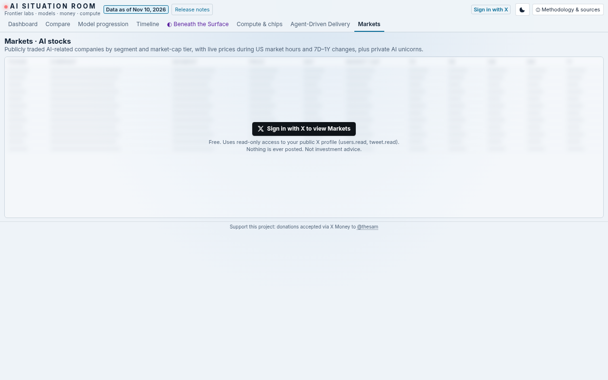

# AI Situation Room

A one-page dashboard that tracks the frontier AI labs (OpenAI, Anthropic, Google DeepMind, xAI, Meta, Mistral, DeepSeek and Alibaba/Qwen): models, benchmarks, economics, products, news and compute, with every item dated and sourced.

**Live:** https://ai-situation-room.vercel.app

## Why
AI moves so fast that I wanted one place to see the labs, models, benchmarks and money at a glance.



## Views
- **Dashboard**: a card for each lab, with filter chips, lab toggles, sorting and a monthly activity strip. Every lab card, the Compare table and Model progression use the same fixed set of eight independent benchmarks, in the same order (GPQA Diamond, OTIS Mock AIME, FrontierMath Tiers 1–3 and Tier 4, SimpleQA Verified, ARC-AGI-2, WebDev Arena, Epoch ECI), naming each lab's best model and showing n/r when there is no score. Vendor-reported results are in a collapsed section and are not comparable.
- **Compare**: the labs side by side, plus the apples-to-apples benchmark table
- **Model progression**: each lab's model lineage and the same independent benchmark set
- **Timeline**: May 2026 to now, with clearly labelled estimates beyond
- **Beneath the Surface**: what labs say compared with what the data shows
- **Compute & chips**
- **Agent-Driven Delivery**: a weekly brief
- **Markets**: 111 publicly traded AI-related stocks by segment and market-cap tier, with 7-day, 1-month, 3-month, 6-month and 1-year change columns, plus private AI unicorns with sourced valuations. During US market hours, price and day change refresh about once a minute from free, delayed Yahoo Finance quotes; outside those hours the last close is shown. The Markets tab is available to people who Sign in with X (read-only `users.read` and `tweet.read`; nothing is posted).





## Run it
It's a plain static site with no build step and no external JavaScript. Open `index.html` in a browser, or run:

```
python3 -m http.server
```

Styles are Tailwind CSS v4, compiled to `style.css` from `tools/tw/input.css`. The data lives in `data/`. Sign in with X and the live quote API run only when the site is deployed with the host's environment variables (those values are never committed).

## Markets data and refresh scripts
Market data comes from free, keyless, delayed Yahoo Finance endpoints. `python3 tools/refresh-markets.py` rewrites `data/markets.js` and the gated API snapshots under `api/` (tickers and unicorns are edited in `tools/markets-universe.json`). `python3 tools/build-bench-matrix.py` rebuilds the benchmark table from Epoch AI's public data (`tools/bench-models.json` maps the models). `tools/daily-markets-deploy.sh` refreshes the market data and deploys it (needs a `VERCEL_TOKEN` env var); `--verify-only` checks the public `/api/markets-status` endpoint. On the live site, `/api/markets` and `/api/quotes` require a signed-in session; `data/markets.js` stays in this repo as the source snapshot and is not served publicly. **Not investment advice.** Data is delayed and may be incomplete.

## Contributing
Feel free to use it, fork or clone it, and open an issue or pull request with ideas. Collaboration is welcome.

## License
AGPL-3.0. Copyright (C) 2026 Sam Hosseini. See [LICENSE](LICENSE). If you run a modified version as a public website, the AGPL requires you to share your source code with its users.

## Support
Support this project: donations accepted via X Money to [@thesam](https://x.com/thesam).
